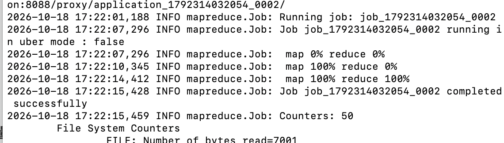
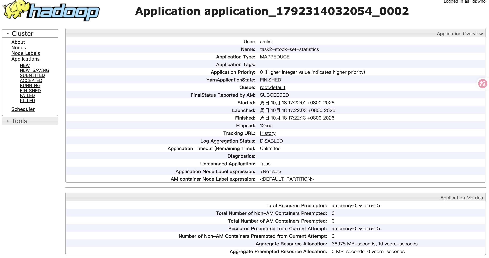
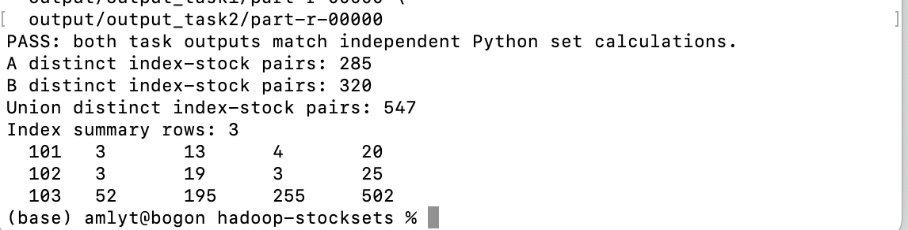

# 作业5：基于 Hadoop MapReduce 的股票成分股集合分析

## 1. 项目简介

本项目在 **macOS 单机伪分布式 Hadoop** 环境中，使用 Java 编写两个连续的 MapReduce 作业，对 `A.txt` 和 `B.txt` 中的股票成分股进行集合关系判断和数量统计。

- **任务1**：针对每组“指数编号 + 股票代码”，标记 `BOTH`（两个文件均出现）、`A_ONLY`（仅 A 出现）或 `B_ONLY`（仅 B 出现）。
- **任务2**：读取任务1的输出，分别统计每个指数的交集数量、A 独有数量、B 独有数量、并集数量。

同一输入文件内的重复股票记录仅计一次；不同指数下的同名股票分开处理。输出按指数编号升序排列，任务1中同一指数下的股票代码按升序排列。

## 2. 实验环境

| 项目 | 配置 |
| --- | --- |
| 操作系统 | macOS（Apple Silicon，arm64） |
| JDK | OpenJDK 17（此前配置为 17.0.20.1） |
| Hadoop | 3.5.0 |
| 部署模式 | 单机伪分布式，HDFS + YARN |
| HDFS NameNode Web | http://localhost:9870 |
| YARN ResourceManager Web | http://localhost:8088 |
| 编程语言 | Java |

运行前通过 `jps` 检查 `NameNode`、`DataNode`、`SecondaryNameNode`、`ResourceManager` 和 `NodeManager` 是否存在。

## 3. 数据格式与项目结构

输入为两个文本文件：`A.txt`、`B.txt`。每行两列，用空格或制表符分隔：

```text
指数编号 股票代码
```

其中指数编号为 `101`、`102`、`103`，代表作业中简化的三大股票指数编号；源程序将空白行跳过，对非法列数或非法指数编号报错。正式统计使用项目根目录下的 `A.txt`、`B.txt`；如保留 `sample-data/`，其中内容仅供本地演示测试，不参与正式作业运行。

```text
hadoop-stocksets/
├── A.txt
├── B.txt
├── src/main/java/com/example/hadoop/
│   ├── StockLogic.java
│   └── StockSetJobs.java
├── target/
│   └── hadoop-stocksets-1.0.0.jar
├── output/
│   ├── output_task1/part-r-00000
│   └── output_task2/part-r-00000
├── screenshots/
│   ├── yarn-task0.png
│   ├── yarn-task1.png
│   └── yarn-task2.png
├── scripts/
│   └── verify_outputs.py
├── pom.xml
├── .gitignore
└── README.md
```

## 4. MapReduce 设计思路

### 4.1 任务1：集合关系判断

1. 使用 `MultipleInputs` 分别读取 `A.txt` 与 `B.txt`，由 `AMapper`、`BMapper` 输出来源标记 `A` 或 `B`。
2. Map 输出的键为 `指数编号\t股票代码`，值为来源标记。具有相同键的记录在 Reduce 阶段归并。
3. `RelationReducer` 对每个键分别记录是否出现过 A、B。使用布尔标记消除同一文件内的重复记录：
   - A、B 都出现：`BOTH`；
   - 只出现 A：`A_ONLY`；
   - 只出现 B：`B_ONLY`。
4. 使用一个 Reducer 并依靠 Hadoop 对 Text 键的排序，使结果整体按指数编号、股票代码升序输出。

输出格式：

```text
指数编号    股票代码    关系标记
```

### 4.2 任务2：交集、差集与并集统计

1. 从 `output_task1` 读取任务1结果，Mapper 输出 `指数编号 -> 关系标记`。
2. `StatsReducer` 按指数编号统计 `BOTH`、`A_ONLY`、`B_ONLY` 的数量。
3. 并集数量等于上述三类数量之和。使用一个 Reducer 输出按指数编号升序排列的统计结果。

输出格式（不含表头）：

```text
指数编号    交集数量    A独有数量    B独有数量    并集数量
```

## 5. 编译与运行步骤

在 `hadoop-stocksets` 项目根目录执行以下命令。

### 5.1 编译 Java 并生成 JAR

本实验直接使用已有的 JDK 17 与 Hadoop 类路径，不依赖额外安装 Maven：

```bash
mkdir -p target/classes
javac --release 17 -encoding UTF-8 \
  -cp "$(hadoop classpath --glob)" \
  -d target/classes \
  src/main/java/com/example/hadoop/*.java

jar cfe target/hadoop-stocksets-1.0.0.jar \
  com.example.hadoop.StockSetJobs \
  -C target/classes .
```


### 5.2 上传文件至 HDFS

```bash
hdfs dfs -mkdir -p /user/$USER/hw5/input
hdfs dfs -put -f A.txt B.txt /user/$USER/hw5/input/
hdfs dfs -ls /user/$USER/hw5/input/
```

### 5.3 提交两个连续的 MapReduce 任务

```bash
hadoop jar target/hadoop-stocksets-1.0.0.jar \
  /user/$USER/hw5/input/A.txt \
  /user/$USER/hw5/input/B.txt \
  /user/$USER/hw5/output_task1 \
  /user/$USER/hw5/output_task2
```

主程序会先执行任务1，任务1成功后再执行任务2。如果重新运行，必须先**确认旧输出不需要保留**，再删除已有的两个 HDFS 输出目录，否则 Hadoop 会因输出目录已存在而拒绝运行。

### 5.4 查看并下载输出

```bash
hdfs dfs -cat /user/$USER/hw5/output_task1/part-r-00000
hdfs dfs -cat /user/$USER/hw5/output_task2/part-r-00000

mkdir -p output/output_task1 output/output_task2
hdfs dfs -get -f /user/$USER/hw5/output_task1/part-r-00000 output/output_task1/
hdfs dfs -get -f /user/$USER/hw5/output_task2/part-r-00000 output/output_task2/
```

## 6. 实际运行结果

### 6.1 任务1：股票集合关系

输出保存为 `output/output_task1/part-r-00000`，每行包含指数编号、股票代码和关系标记。应检查每个“指数编号 + 股票代码”仅出现一次，以及三种标记与 A/B 原始数据相符。

输出原文（前10行）：

```text
101	AAPL	A_ONLY
101	AMGN	A_ONLY
101	AXP	A_ONLY
101	BA	A_ONLY
101	CAT	A_ONLY
101	CRM	A_ONLY
101	CSCO	A_ONLY
101	DIS	A_ONLY
101	DOW	A_ONLY
101	GS	A_ONLY
```

### 6.2 任务2：集合数量统计

从 HDFS 路径 `/user/amlyt/hw5/output_task2/part-r-00000` 读取到以下实际结果（已下载副本到本地 `output/`）：

| 指数编号 | 交集（BOTH） | A独有（A_ONLY） | B独有（B_ONLY） | 并集 |
| --- | ---: | ---: | ---: | ---: |
| 101 | 3 | 13 | 4 | 20 |
| 102 | 3 | 19 | 3 | 25 |
| 103 | 52 | 195 | 255 | 502 |

输出原文：

```text
101	3	13	4	20
102	3	19	3	25
103	52	195	255	502
```

各行均满足：**并集数量 = 交集数量 + A 独有数量 + B 独有数量**。这只能证明结果内部的数量关系一致，并不能单独证明所有股票均被正确分类；完整验证方法见第 11 节。

由任务2输出可进一步推导以下集合规模（均以“指数编号 + 股票代码”为统计单位）：

| 指数编号 | A 中去重后数量 = BOTH + A_ONLY | B 中去重后数量 = BOTH + B_ONLY | 并集数量 | Jaccard 重合率 = BOTH / 并集 |
| --- | ---: | ---: | ---: | ---: |
| 101 | 16 | 7 | 20 | 15.00% |
| 102 | 22 | 6 | 25 | 12.00% |
| 103 | 247 | 307 | 502 | 10.36% |
| **各指数合计** | **285** | **320** | **547** | — |

其中合计行是不同指数分别计数再相加，**不等于全市场的去重股票代码总数**。从任务2可推导任务1的结果应包含 **547 行不同的指数—股票键**，但是否确实有这么多行，仍应通过任务1输出及独立校验脚本核实。上述 Jaccard 重合率仅反映两份输入样本的集合重合程度，不能据此推断完整市场的真实重合率。

## 7. Hadoop Web 作业运行状态及截图

**MapReduce 执行日志截图（以实际日志为准）：**




**任务1的 YARN Web 截图：**


**任务2的 YARN Web 截图：**




## 8. 遇到的问题与解决方法

以下主要为搭建本次作业所复用的 Hadoop 单机伪分布式环境时实际遇到的问题：

1. **Hadoop 安装包下载缓慢**：Homebrew 默认下载线路速度较慢，临时切换清华 TUNA 的 Homebrew Bottle 镜像后完成安装。
2. **SecondaryNameNode 主机名无法解析**：启动脚本尝试连接 `bogon`，出现 `Could not resolve hostname bogon`。在 `hdfs-site.xml` 中设置 `dfs.namenode.secondary.http-address=localhost:9868` 后解决。
3. **NameNode 初始化失败**：最初的 `hadoop.tmp.dir` 使用了错误的 `file:///...` 形式，出现 `URI has an authority component`，导致 NameNode 的元数据目录未创建。改成普通本地目录 `/Users/amlyt/hadoop_tmp`，明确配置 HDFS 存储目录，在首次成功初始化后正常启动。已有 HDFS 数据时不可随意重新执行 `namenode -format`。
4. **macOS 原生库提示**：执行 HDFS 命令时可能出现 `Unable to load native-hadoop library` 警告，但本次文件上传和结果读取仍能正常完成；该提示本身不等同于作业失败。

## 9. 性能、可扩展性与工程可靠性分析

> **分析边界**：本节的“现状”对应本次实际提交的 Java 代码；“优化方案”是基于现状提出的后续设计，**尚未在这次 Hadoop 运行中实现或完成性能实测**。

### 9.1 计算规模与运行开销的来源

本次终端显示 `A.txt` 为 2,339 字节、`B.txt` 为 2,611 字节，输入总量为 **4,950 字节（约 4.83 KiB）**；任务2给出的并集数量合计为 **547**。输入规模远小于典型的分布式海量数据处理任务，因此本实验的主要目的在于验证 **HDFS 存取、MapReduce 分组与排序、YARN 调度以及多作业依赖**，而不是证明单机集群可以取得大数据吞吐优势。

设 `N` 为 A/B 原始输入记录总数（包含重复），`U` 为去重后的“指数—股票”组合数量，`K` 为出现的指数编号种类数。本实现的大致成本如下：

| 阶段 | 当前处理方式 | 主要成本 | 关键约束 |
| --- | --- | --- | --- |
| 任务1 Map | 顺序解析 A/B 每一行并输出复合键与来源 | 记录处理约 `O(N)`；产生约 `N` 个中间记录 | 原始重复项也参与 Shuffle |
| 任务1 Shuffle/Sort | 根据复合键排序、按键分组 | 需要传输、排序与归并中间数据；排序量与 `N` 有关 | 单 Reducer 汇集所有键 |
| 任务1 Reduce | 每个键检查 A/B 来源是否出现过 | 对每组只保存两个布尔标记；总体处理约 `O(N)` | 输出约 `U` 行 |
| 任务间 HDFS | 写入并重新读取 `output_task1` | 额外约 `U` 行的持久化与读取开销 | 两个 Job 之间存在数据依赖 |
| 任务2 Map/Reduce | 读取约 `U` 行关系标记，按指数统计 | Mapper 约 `O(U)`；Reducer 处理约 `O(U)` | `K` 很小时不需要很多 Reducer |

MapReduce 框架还需启动应用、分配容器以及进行磁盘落盘与网络 Shuffle。这些开销是实际总耗时的重要组成部分，**不能仅用上述渐进时间复杂度解释**。在当前只有一个工作节点的小文件场景中，即使减少少量 CPU 运算，也未必降低整体作业耗时。

### 9.2 单 Reducer 与数据倾斜：排序正确性换来的并行度损失

当前两个 Job 都使用 `setNumReduceTasks(1)`。优点是输出集中在一个 `part-r-00000`，并可直接依赖 Hadoop 对 `Text` 键的排序满足老师要求的升序输出；缺点是任务1的所有去重分组都汇集到同一个 Reducer，无法利用多个 Reduce 任务并行处理。

- **潜在问题**：当 `N` 和 `U` 很大时，单个 Reducer 的 Shuffle、归并和输出阶段可能成为瓶颈；只有一台 Mac 时，增加 Reducer 还可能因为 CPU、内存与容器资源不足而变慢。
- **优化方案**：在真正的多节点集群中增加任务1的 Reducer 数量，通过有序范围分区（如 `TotalOrderPartitioner` 配合采样得到的分界键）将复合键划分为不相交且按升序排列的范围。每个分区内部保持有序，最终在确认分区边界正确后按分区顺序汇总，才能保证**跨输出文件的全局升序**。
- **特别注意**：不能简单地将一个 Reducer 改成多个并沿用默认 Hash 分区，就认为多个 `part-r-*` 拼接后全局有序。也不能只按指数划分三个 Reducer 就认为负载均衡：从现有输出看，`103` 的并集为 502，而其他指数分别只有 20、25，按指数分区会使某个 Reducer 更繁忙。
- **选择理由**：当前小规模作业保留单 Reducer 更简单、稳定且易于验收；范围分区应在多节点、大数据且确有瓶颈的前提下实施。

### 9.3 重复记录在 Reduce 才去重：Shuffle 冗余

当前 Mapper 对每条合法输入记录都发出 `<指数编号\t股票代码, A/B>`，而 `RelationReducer` 才通过 `inA`、`inB` 判断成员关系。这样能确保重复股票不被重复计数，但如果输入中含有大量重复行，重复项仍会占用 Map 输出缓冲区、磁盘 Spill 和 Shuffle 带宽。

**可行改进：使用满足结合律、交换律和幂等性的位标记聚合（Combiner）。** 例如，将 A 来源编码为 `01`，B 来源编码为 `10`；Mapper 输出整数位标记，Combiner 对同一键执行按位或（OR），Reducer 再根据最终状态 `01 / 10 / 11` 输出 `A_ONLY / B_ONLY / BOTH`：

| 来源值 | 局部归并 | 含义 |
| --- | --- | --- |
| `01` 与 `01` | `01` | 同一股票在 A 中重复出现，仍只算一次 |
| `10` 与 `10` | `10` | 同一股票在 B 中重复出现，仍只算一次 |
| `01` 与 `10` | `11` | 同时出现在 A、B 中 |

位或操作不会因为 Combiner 被执行零次、一次或多次而改变结果，因此比较适合作为 Map 端局部去重。**不能未经修改就将当前输出关系标签的 `RelationReducer` 直接用作 Combiner**，因为 Mapper 的来源标签与 Reducer 的最终关系标签在语义上不同。引入此优化需要同步调整 Mapper/Combiner/Reducer 的中间值类型和逻辑，并重新通过重复数据测试。

Combiner 的收益依赖重复率：高度重复的数据可能明显减少中间数据量；如果每条股票记录本来就只出现一次，Combiner 可能增加额外 CPU 开销而几乎无收益。

### 9.4 两个 MapReduce Job 的调度与中间文件开销

当前程序严格按照作业要求：**任务1输出关系表到 `output_task1`，任务2再读取该结果统计并输出 `output_task2`**。优点是阶段清晰、可单独核验、便于追踪错误；代价是需要两次 Job 提交、两轮调度，以及一次中间数据的 HDFS 写入和再读取。

- **在本作业中**：应继续保留两阶段处理，因为题目明确要求任务2对任务1结果进行二次统计，并提交两个输出目录。
- **在非课程约束的生产场景中**：可以研究将关系结果与统计结果合并计算、使用 `MultipleOutputs`、在适当阶段做侧输出，或使用支持 DAG 的计算框架，减少重复启动及 I/O。不过这种方案会改变当前“两次作业”的实验结构，不能未经说明直接替换本次提交的实现。
- **另一个优化方向**：在任务2中将 Mapper 输出改为固定维度计数向量，例如 `<指数编号, (BOTH数, A独有数, B独有数)>`，以加法 Combiner 做局部汇总；但因为本次任务2最终只统计少数几个指数，数据量很小，优先级低于任务1的优化。

### 9.5 键值类型、序列化与磁盘 I/O

当前使用 `Text` 保存形如 `101\tAAPL` 的复合键，代码易读、易调试；但每条 Map 输出包含重复的字符串字段，随着数据量增长会产生较多序列化、内存分配与比较开销。

可考虑使用自定义 `WritableComparable`（整数指数编号 + 股票代码）减少冗余，并明确实现排序、分区与分组的一致语义。只有在 Profile 或 Counter 显示序列化、GC 和排序确实构成成本时才值得增加这部分代码复杂度。

当输入达到较大规模时，还可以评估 `mapreduce.map.output.compress` 等中间结果压缩配置：压缩有机会降低 Shuffle 的磁盘与网络流量，但会增加 CPU 消耗，且压缩 Codec 是否可用依赖 Hadoop 环境。当前几 KiB 的输入文件不足以证明压缩会更快，不应直接开启后宣称提升性能。

### 9.6 数据健壮性和业务可扩展性

当前 `StockLogic.parseInput` 对空行进行忽略，对列数错误或非 `101/102/103` 的指数编号抛出异常。此策略适合教学：能够避免错误数据被悄悄计入结果；但在大型生产数据集上，一行异常记录就可能使整个 Job 失败。

改进方案包括：

1. **数据质量观测**：使用 Hadoop `Counter` 统计有效、空行、格式错误、重复记录等数量；对无法解析的行保留文件名、行号或偏移量及原因，输出到隔离目录，不要无提示地跳过。
2. **输入标准化**：如果业务要求股票代码大小写不敏感，可统一按 `Locale.ROOT` 转大写，并在文档中说明；本次实现尚未做大小写规范化，所以 `aapl` 与 `AAPL` 会被视为不同代码。
3. **开放指数编号**：将当前硬编码的三种指数编号改为可配置的合法集合或规则，便于扩展到更多指数；本次为严格遵循题意，仍只允许 `101`、`102`、`103`。
4. **大计数溢出防护**：当前统计变量为 `int`；在海量记录或长期累积情形下应考虑 `long` / `LongWritable`，并补充溢出测试。
5. **输入隔离与幂等**：每次实验尽量使用独立输出目录，保留 Job ID 和输入数据版本；重跑前要明确是否删除旧输出，避免误删可复核证据。

这些改进可以同时提高可维护性、可追踪性和后续数据源接入能力，并不只是“让程序跑得更快”。

### 9.7 单机伪分布式环境的扩展性限制

本实验只在一台 Apple Silicon Mac 上运行 HDFS 和 YARN，`dfs.replication=1`，能够验证各组件的协作流程，但并不具备真实多机集群的水平扩容效果和冗余容错能力。

如果迁移到多节点集群，可根据实际节点数量、磁盘容量和可靠性目标配置 HDFS 副本数、YARN 资源、Map/Reduce 并行度、跨节点数据本地性与重试策略。需要注意：多节点会改善部分并行计算和单节点故障恢复条件，**但不会自动解决单 Reducer 的瓶颈或错误分区策略**；扩容后仍需结合测量结果调优。

### 9.8 改进优先级与取舍总结

| 优先级 | 问题 | 建议改进 | 预期收益 | 代价或适用边界 | 当前状态 |
| --- | --- | --- | --- | --- | --- |
| P0 | 仅有聚合数量自洽检查 | 独立脚本逐行复核任务1、任务2 | 提升正确性证据与可复现性 | 无需修改 MapReduce 实现 | **提供脚本，待本机运行** |
| P1 | 重复数据增加 Shuffle 流量 | 位掩码 OR 型 Combiner | 重复率高时减少中间记录 | 修改中间值类型，并需回归测试 | 方案设计 |
| P1 | 任务1单 Reducer | 多 Reducer + 有序范围分区 | 大规模/多节点时提高并行度 | 分区采样、负载均衡、全局顺序 | 方案设计 |
| P2 | 错误数据导致 Job 整体失败 | Counter + 隔离坏记录 + 输入校验 | 提高数据质量与运行可观测性 | 需要明确容错策略 | 方案设计 |
| P2 | 序列化与 Shuffle I/O | 紧凑 Writable、按需压缩 | 大数据量时可能降低 I/O/GC | CPU 与实现复杂度上升 | 方案设计 |
| P3 | Job 启动与中间 HDFS I/O | 在非本作业场景研究融合计算 | 小文件或频繁批处理时减少开销 | 会改变课程要求的两阶段流程 | 仅供拓展 |

## 10. 性能评估：如何用实验验证优化是否真的有效

### 10.1 可观察指标与获取方式

对比优化方案时，不应只观察命令有没有报错，还在 `http://localhost:8088` 对每个 Job 查看运行时间、任务数量和 Counters

| 指标 | 作用 | 判断依据 |
| --- | --- | --- |
| Job 运行时间（Elapsed Time） | 衡量提交后总体执行耗时 | 对同一数据重复运行、比较中位数 |
| Map input / output records | 观察 Mapper 输入量和产生的中间键值对量 | 如果重复率高，Combiner 可能降低后续传输量 |
| Reduce input groups / records | 观察去重后的键数与聚合输入量 | 任务1分组数应与任务1最终记录数对应 |
| Spilled Records | 反映 Map/Reduce 过程中的溢写与归并负担 | 可与缓冲、压缩和 Combiner 方案对比 |
| HDFS / FileSystem bytes read、written | 观察实际磁盘与文件系统 I/O | 分析中间结果持久化的开销 |
| CPU time、GC time（若页面可见） | 判断瓶颈是计算、GC 还是 I/O | 避免误将 CPU 增长当成优化成功 |
| 输出行数及独立校验结果 | 确认优化没有改变业务语义 | **所有优化版本必须输出完全一致** |

本实验通过 Hadoop YARN ResourceManager Web 页面采集两个 MapReduce 作业的运行指标，实验环境为 macOS 单机伪分布式 Hadoop 3.5.0。

| 性能指标 | 任务1：集合关系判断 | 任务2：集合数量统计 |
|---|---|---|
| 作业名称 | task1-stock-set-relations | task2-stock-set-statistics |
| Application Type | MAPREDUCE | MAPREDUCE |
| YARN Application State | FINISHED | FINISHED |
| Final Status | SUCCEEDED | SUCCEEDED |
| 启动时间 | 17:21:47 | 17:22:01 |
| ApplicationMaster 启动时间 | 17:21:48 | 17:22:03 |
| 完成时间 | 17:21:57 | 17:22:13 |
| **运行耗时（Elapsed）** | **10 s** | **12 s** |
| 累计内存资源分配量 | 39878 MB·s | 36978 MB·s |
| 累计 CPU 核资源分配量 | 22 vcore·s | 19 vcore·s |
| 被抢占的内存资源 | 0 | 0 |
| 被抢占的 vCore 资源 | 0 | 0 |

### 10.2 实际运行性能分析
根据 Hadoop YARN ResourceManager Web 页面采集的运行数据，任务1和任务2均成功执行，最终状态为 FINISHED，完成状态为 SUCCEEDED，证明两个 MapReduce 作业均已正常结束。

（1）执行时间分析

任务1运行耗时为10秒，任务2运行耗时为12秒。

本次实验处理的数据规模较小，在单机伪分布式 Hadoop 环境中，作业启动、资源申请、ApplicationMaster 初始化、Map/Reduce 任务调度以及 HDFS 文件访问等固定开销可能占据较大比例。

因此，本次作业的总运行时间不能简单等同于算法本身的计算时间。

（2）资源使用分析

任务1的累计内存资源分配量为39878 MB·s，累计 CPU 核资源分配量为22 vcore·s。

任务2的累计内存资源分配量为36978 MB·s，累计 CPU 核资源分配量为19 vcore·s。

这些指标反映 YARN 为应用分配的资源随时间累计的数量，不能直接解释为程序实际使用的内存或 CPU 时间。

两项作业均未出现资源抢占，说明本次执行过程中没有记录到 YARN 资源抢占事件。

（3）性能瓶颈分析

当前程序采用单 Reducer 实现全局排序，虽然能够满足实验要求，但也限制了 Reduce 阶段的并行处理能力。

此外，任务1在 Reduce 阶段完成重复记录去重，Mapper 仍会输出重复记录，因此高重复率数据可能增加网络 Shuffle、排序和磁盘溢写开销。

任务2依赖任务1的 HDFS 输出，两个独立 MapReduce 作业需要分别启动并进行中间结果读写，存在额外的调度与磁盘 I/O 开销。

（4）后续优化方向

后续可以考虑引入 Combiner，在 Map 端提前合并重复股票记录，减少 Shuffle 数据量；采用分区策略和多个 Reducer 提高并行度；优化中间数据格式以降低序列化开销。

同时，可以构造不同数据规模和重复率的测试集，比较优化前后的运行耗时、Map 输出记录数、Shuffle 数据量和 Spilled Records，以定量验证优化效果。

以上优化属于后续改进方案，本次实验尚未进行优化前后的对照性能测试。

## 11. 正确性验证与边界测试

### 11.1 从任务2反推任务1的可验证不变量

对每个指数 `i`，应满足：

- `|A_i ∩ B_i| = BOTH_i`；
- `|A_i - B_i| = A_ONLY_i`，`|B_i - A_i| = B_ONLY_i`；
- `|A_i| = BOTH_i + A_ONLY_i`，`|B_i| = BOTH_i + B_ONLY_i`；
- `|A_i ∪ B_i| = BOTH_i + A_ONLY_i + B_ONLY_i = |A_i| + |B_i| - |A_i ∩ B_i|`。

对于本次已经取得的结果，三类记录分别合计为 **58、227、262**，相加得到 **547**。因此任务1应输出 **547 条不重复的“指数—股票”关系记录**，任务2应输出三条指数汇总记录。可以先做快速检查：

```bash
wc -l output/output_task1/part-r-00000
wc -l output/output_task2/part-r-00000
```

上述行数只能检查总量，不能发现“某一只股票被错误分类、但总数恰好相同”的情况。因此还应对原始 A/B 文件**分别去重后**，独立计算完整关系表与汇总表，再进行逐行比较。

### 11.2 独立 Python 校验脚本（不依赖 Hadoop）

项目附带 `scripts/verify_outputs.py`，使用 Python 集合运算重新计算任务1、任务2的期望结果，检查：

- 同一个文件内重复行是否只计一次；
- 相同股票在不同指数下是否分开处理；
- `BOTH / A_ONLY / B_ONLY` 是否逐条正确；
- 任务1与任务2是否整体升序、是否存在遗漏、额外或重复记录；
- 任务2各指数数量是否与原始 A/B 集合完全一致。

把脚本放在项目的 `scripts/` 目录后，运行：

```bash
python3 scripts/verify_outputs.py \
  A.txt B.txt \
  output/output_task1/part-r-00000 \
  output/output_task2/part-r-00000
```

**独立正确性验证结果**

本实验使用 Python 集合运算对 MapReduce 输出进行独立校验。验证程序分别读取原始输入文件 A.txt、B.txt，对指数编号与股票代码组成的复合键进行去重，并计算交集、差集和并集，随后与两个 MapReduce 作业的输出逐行比较。

验证结果如下：

* A 文件去重后包含 285 条指数—股票记录。
* B 文件去重后包含 320 条指数—股票记录。
* 两份数据的并集包含 547 条不同记录。
* 任务 2 共生成 3 条指数统计记录。

**验证结论：**两个 MapReduce 任务的输出与独立 Python 集合运算结果完全一致，说明程序正确实现了集合关系判断、重复记录去重、结果排序和数量统计。




### 11.3 关键边界情况

| 测试情况 | 期望结果 | 原因 |
| --- | --- | --- |
| 同一文件含重复的 `101 AAPL` | 对应指数与股票仅输出一条关系 | 集合去重语义 |
| A、B 均有相同的指数与股票 | `BOTH` | 集合交集 |
| 只在 A / 只在 B | `A_ONLY` / `B_ONLY` | 两个方向的差集 |
| `101 AAPL` 与 `102 AAPL` | 视为两个不同键 | 指数编号是键的一部分 |
| 输入含空白行、混合空格和制表符 | 忽略空行、正常解析两列 | 符合输入格式 |
| 非法列数或指数编号 | 当前 Java 代码应报告错误，而非静默计数 | 输入校验设计 |
| 任一输入文件为空 | 结果等于另一文件的独有集合 | 边界集合关系 |
| 输出被修改或排序发生变化 | 独立校验必须失败 | 避免只看行数而误判 |

校验脚本已针对上述典型场景做过独立的逻辑测试；它是**辅助验收工具**，不替代通过 Hadoop YARN 运行两个 Java MapReduce Job 。

## 12. 实验结论与后续改进路线

本次实验在 macOS 单机伪分布式 Hadoop 3.5.0 环境下完成了从 HDFS 输入、`MultipleInputs` 读取、MapReduce 分组去重，到两阶段统计和结果导出的处理链。当前任务2输出分别为 `101: 3/13/4/20`、`102: 3/19/3/25`、`103: 52/195/255/502`，满足基本的集合恒等关系；通过 YARN 页面可以提供作业运行状态的截图证据。

**当前实现的价值**在于逻辑清晰、完全覆盖课程所需的两次 MapReduce 任务，并保证小规模数据的全局有序输出。**当前实现的局限**则主要是任务1的单 Reducer 串行聚合、重复输入增加 Shuffle 开销、两次 Job 的固定调度成本，以及数据质量观测和可配置能力不足。

实际改进时应采用“**先保证正确性、再采集基线指标、最后逐项调优**”的顺序：先执行独立校验；再对高重复率样本研究局部去重 Combiner；当转移到多节点及更大规模数据时研究范围分区与并行 Reduce；最后评估压缩、序列化和长期数据质量管理。所有性能结论都应通过同条件对照实验取得，不能将理论可行性直接当成实测提升。


### 参考资料

1. [Apache Hadoop 3.5.0：MapReduce Tutorial](https://hadoop.apache.org/docs/r3.5.0/hadoop-mapreduce-client/hadoop-mapreduce-client-core/MapReduceTutorial.html)：Mapper / Reducer、Shuffle、Combiner、Counters 与性能调优说明。
2. [Apache Hadoop：MultipleInputs API](https://hadoop.apache.org/docs/stable/api/org/apache/hadoop/mapreduce/lib/input/MultipleInputs.html)：多个路径使用不同 Mapper 的机制。
3. [Apache Hadoop 3.5.0：Partitioner API](https://hadoop.apache.org/docs/current/api/org/apache/hadoop/mapreduce/Partitioner.html)：多 Reducer 的分区职责与机制。


