# 实验 2：基于 Hadoop MapReduce 的用户信贷数据分析与风险预测

> 项目名：`hadoop-credit-risk`  
> 实验日期：2026 年 11 月 7 日（日志显示时区 UTC+08:00）  
> 实验环境：macOS（Apple Silicon）、Java 17、Hadoop 3.5.0、Maven 3.10.0，HDFS + YARN 单机伪分布式  
> 运行证据：[`screenshots/`](screenshots/) 下的终端截图与 YARN 作业截图

本项目使用 Hadoop MapReduce 处理银行客户信贷数据，完成按开户机构统计、资产均值比较、全体客户资产四分位数计算、资产分层与资产结构统计，以及朴素贝叶斯模型训练和测试集风险标签预测。五个实验任务均有实际操作截图，其中任务 5 保留了一次失败的诊断记录和后续训练、预测成功的记录。

## 1. 实验任务与运行结果

| 任务 | MapReduce 主类 | 主要输出 | 实验记录 |
| --- | --- | --- | --- |
| 任务 1：开户机构统计 | `OrgStatsJob` | 机构客户数、总资产、总负债、标签为 1 的客户数 | YARN `FINISHED / SUCCEEDED` |
| 任务 2：机构平均资产比较 | `OrgAverageJob` | 各机构资产大于等于平均值、低于平均值的客户数 | YARN `FINISHED / SUCCEEDED` |
| 任务 3：资产四分位数 | `QuartilesJob` | Q25、Q50、Q75 | YARN `FINISHED / SUCCEEDED` |
| 任务 4：分层资产结构 | `AssetStructureJob` | 四档客户群、七类资产占比（由高到低） | YARN `FINISHED / SUCCEEDED` |
| 任务 5：信用风险预测 | `CreditRiskTrainJob`、`CreditRiskPredictJob` | 朴素贝叶斯模型、`CUST_ID` 与预测标签 | 首次训练失败；后续训练与预测均有 `FINISHED / SUCCEEDED` 证据 |

下表是实验截图显示的成功作业编号（不包含此前完成的股票集合实验作业）：

| 任务 | YARN Application ID | 运行结果 |
| --- | --- | --- |
| 任务 1 | `application_1792314032054_0003` | SUCCEEDED |
| 任务 2 | `application_1792314032054_0004` | SUCCEEDED |
| 任务 3 | `application_1792314032054_0005` | SUCCEEDED |
| 任务 4 | `application_1792314032054_0006` | SUCCEEDED |
| 任务 5：初次模型训练 | `application_1792314032054_0007` | FAILED（Shuffle Fetch 错误） |
| 任务 5：后续模型训练 | `application_1794051389270_0001` | SUCCEEDED |
| 任务 5：后续模型预测 | `application_1794051389270_0002` | SUCCEEDED |

> 注意：这里只陈述截图可验证的作业结果。首次失败的具体环境修复步骤并未完整保留在《结果记录》中，因此不将任何单一网络设置写成已经证实的根本原因。

## 2. 实验环境与目录结构

主要组件：

- Hadoop HDFS：存放 `train.csv`、`test.csv` 及各任务输出。
- Hadoop YARN：调度 MapReduce 训练、统计和预测作业；Web 页面默认 `http://localhost:8088`。
- Java 17 + Maven：编译和打包 Java MapReduce 程序。
- Hadoop JobHistory：查看已完成作业、Counters 及失败诊断。

项目预期目录结构如下。**本说明包仅包含 `README.md` 和 `screenshots/`；源码、JAR、CSV、实际输出文件保留在你已有的项目目录中。**

```text
hadoop-credit-risk/
├── README.md
├── pom.xml
├── src/main/java/com/example/creditrisk/
│   ├── TrainRow.java
│   ├── JobUtils.java
│   ├── OrgStatsJob.java
│   ├── OrgAverageJob.java
│   ├── QuartilesJob.java
│   ├── AssetStructureJob.java
│   ├── CreditRiskFeatures.java
│   ├── CreditRiskTrainJob.java
│   └── CreditRiskPredictJob.java
├── input/
│   ├── train.csv              # 含标签，仅本地使用
│   └── test.csv               # 无标签，仅本地使用
├── output/
│   ├── task1/
│   ├── task2/
│   ├── task3/
│   ├── task4/
│   └── task5/
│       ├── model.tsv          # 训练模型（下载副本）
│       └── part-r-00000      # 预测结果（下载副本）
├── target/
│   └── hadoop-credit-risk-1.0.0.jar
└── screenshots/              # 本包包含的 16 张原始实验截图
```

## 3. 数据集与预处理

实验使用两份 CSV 文件，均由课程提供的数据集准备环节产生：

- `train.csv`：15 列，第 3 列为 `bad_good`，用于任务 1～4 与任务 5 的模型训练。
- `test.csv`：14 列，不包含 `bad_good`，用于任务 5 的模型预测。

两份文件字段位置存在差异，因此不能对训练集与测试集使用完全相同的数字列索引。

| 业务字段 | `train.csv`（从 0 开始） | `test.csv`（从 0 开始） |
| --- | ---: | ---: |
| `CUST_ID` | 0 | 0 |
| `OPEN_ORG_NUM` | 1 | 1 |
| `bad_good` | 2 | 不存在 |
| `CUST_SAVING_AMT` | 3 | 2 |
| `CUST_ASSET_AMT` | 10 | 9 |
| `CUST_DEBT_AMT` | 11 | 10 |
| `G_OS_PRCP_SUM` | 12 | 11 |
| `LOAN_FLAG` | 13 | 12 |
| `CRED_FLAG` | 14 | 13 |

金额类字段按各个任务的处理约定清洗：空数值按 0 处理；格式异常的记录需查看 MapReduce Counter，不能直接假定所有输入行都成功参与计算。预测阶段对金额做离散分桶，并统一训练集、测试集的特征编码。

**标签说明**：程序将 `bad_good=1` 当作统计的目标类。数据集原始说明中 `0/1` 与“逾期/未逾期”的精确定义需要单独核对，README 不将未核实的编码含义写成事实。

## 4. 任务 1：按开户机构汇总客户统计

Mapper 从 `train.csv` 提取开户机构、客户资产、客户负债及标签，使用 `OPEN_ORG_NUM` 为 Key；Reducer 按机构合并，输出如下四项统计量：

```text
机构编号<TAB>客户数量,总资产,总负债,标签为1的客户数量
```

例如，记录中的任务 1 实际输出包含：

| 机构 | 客户数量 | 总资产 | 总负债 | 标签为 1 的客户数 |
| --- | ---: | ---: | ---: | ---: |
| 1001 | 1,254 | 184,485,852.19 | 112,193,577.37 | 32 |
| 1002 | 793 | 85,762,009.43 | 28,727,466.60 | 5 |
| 1003 | 887 | 116,772,867.93 | 23,132,764.24 | 9 |

输出截图：

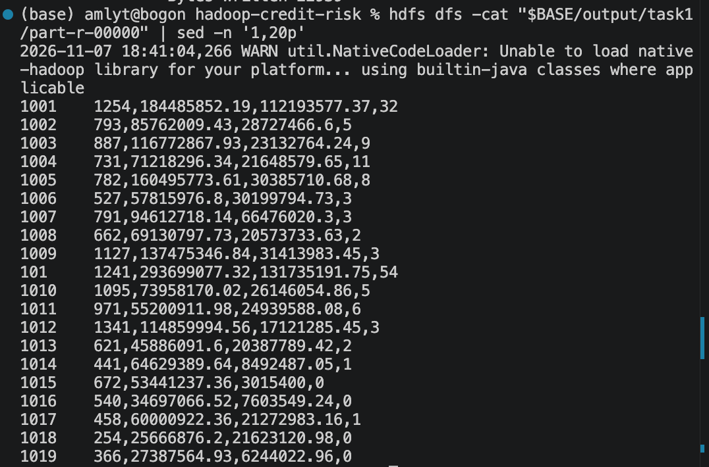

对应 YARN 作业状态与提交/运行记录：

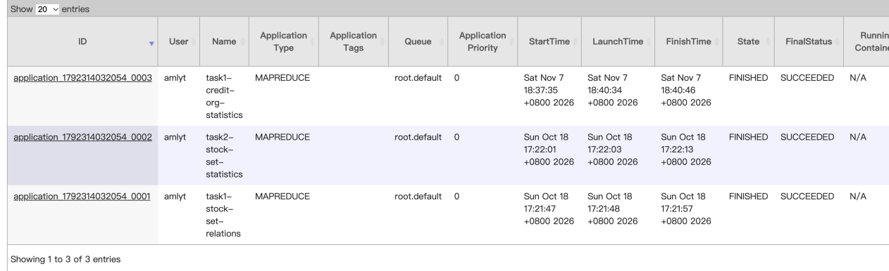

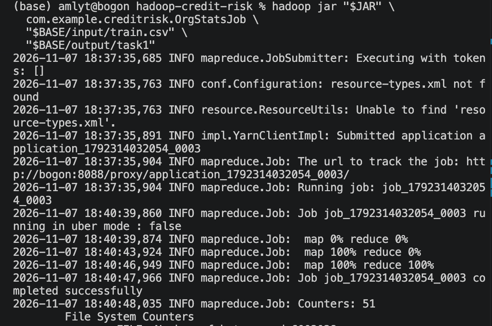

> `task1-yarn-success.png` 中还出现以前的股票集合任务，只有 `task1-credit-org-statistics` 这一行属于当前信贷实验。

## 5. 任务 2：机构平均资产比较

任务 2 读取任务 1 的机构统计结果，计算各开户机构平均资产，并将机构资产均值相关信息供 Mapper 使用。随后逐个比较客户总资产与其机构均值：

- 客户资产 **大于或等于** 机构平均资产：计入第一组；
- 客户资产 **小于** 机构平均资产：计入第二组。

输出格式：

```text
机构编号<TAB>达到或超过机构平均资产的客户数,低于机构平均资产的客户数
```

记录中展示的实际结果示例：

| 机构 | 大于等于平均值 | 低于平均值 | 与任务 1 客户数核对 |
| --- | ---: | ---: | --- |
| 1001 | 232 | 1,022 | 232 + 1,022 = 1,254 |
| 1002 | 106 | 687 | 106 + 687 = 793 |
| 1003 | 144 | 743 | 144 + 743 = 887 |

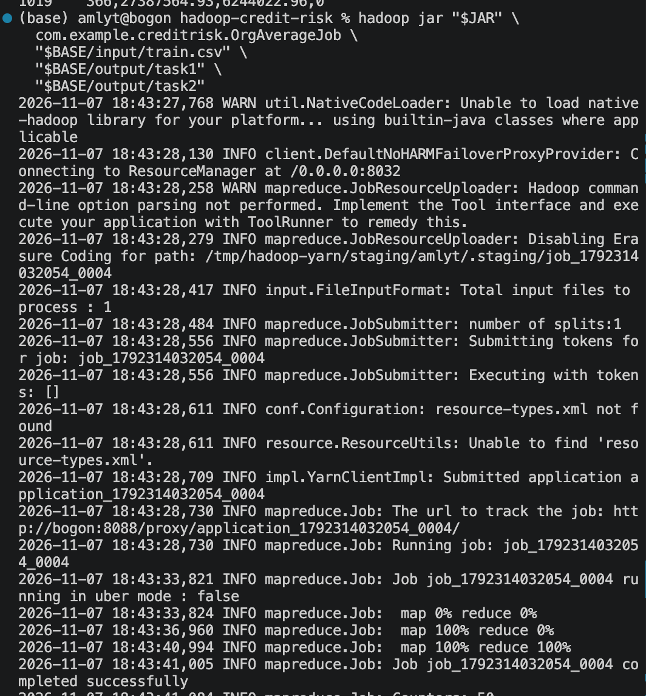

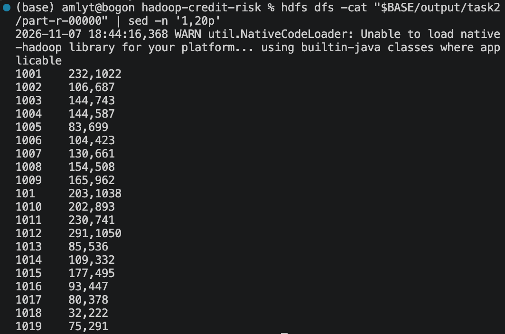

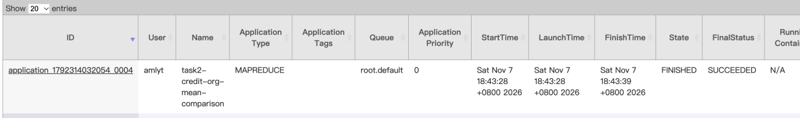

## 6. 任务 3：客户总资产四分位数

从训练数据提取 `CUST_ASSET_AMT`，以 Hadoop 的数值类型作为 Map 输出 Key，利用 Shuffle 排序及单 Reducer 获取全局有序资产值，再按线性插值定义计算四分位数：

\[
h=(N-1)p,\quad p\in\{0.25,0.50,0.75\}
\]

本次记录中的**真实运行结果**为：

| 统计指标 | 实际数值 |
| --- | ---: |
| Q25 | **1,127.35** |
| Q50（中位数） | **6,501.38** |
| Q75 | **49,173.11** |

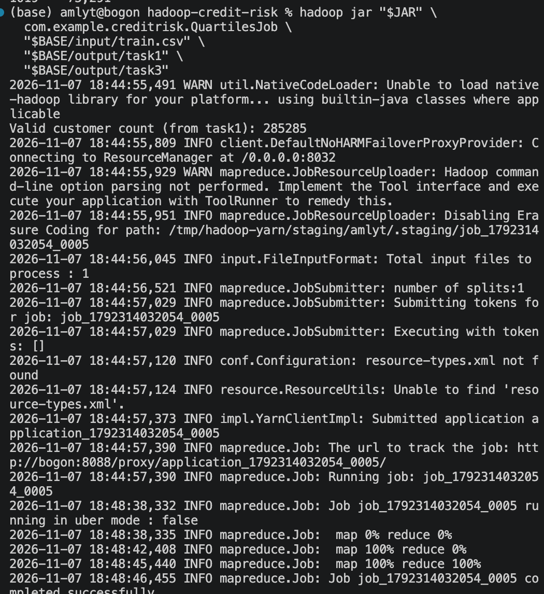

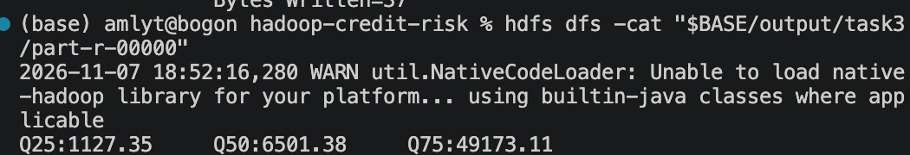

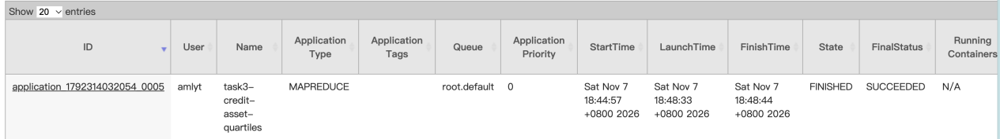

## 7. 任务 4：客户资产分层与结构分析

根据任务 3 的四分位数，对客户进行四档划分（边界值按左闭右开处理；最高档包含 Q75）：

| 资产等级 | 划分规则 |
| --- | --- |
| 低资产 | 资产 `< Q25` |
| 中等资产 | `Q25 ≤ 资产 < Q50` |
| 较高资产 | `Q50 ≤ 资产 < Q75` |
| 高资产 | `资产 ≥ Q75` |

按照存款、理财、私人理财、基金、国债、银保通、贵金属七类资产分别求和，并使用这七类资产的合计作为分母计算占比。每个资产等级内部按占比降序排列。

记录截图中，各资产等级存款占比分别为：

| 资产等级 | 存款占比 | 记录中的特点 |
| --- | ---: | --- |
| 低资产 | 0.9963 | 主要集中在存款 |
| 中等资产 | 0.9858 | 存款仍占绝大多数 |
| 较高资产 | 0.9567 | 理财、基金等占比有所上升 |
| 高资产 | 0.5602 | 理财占比 0.2949，私人理财占比 0.1086 |

> 上述占比为截图展示的四位小数结果，不能直接等同于客户人数占比，也不是所有客户的总资产占比。

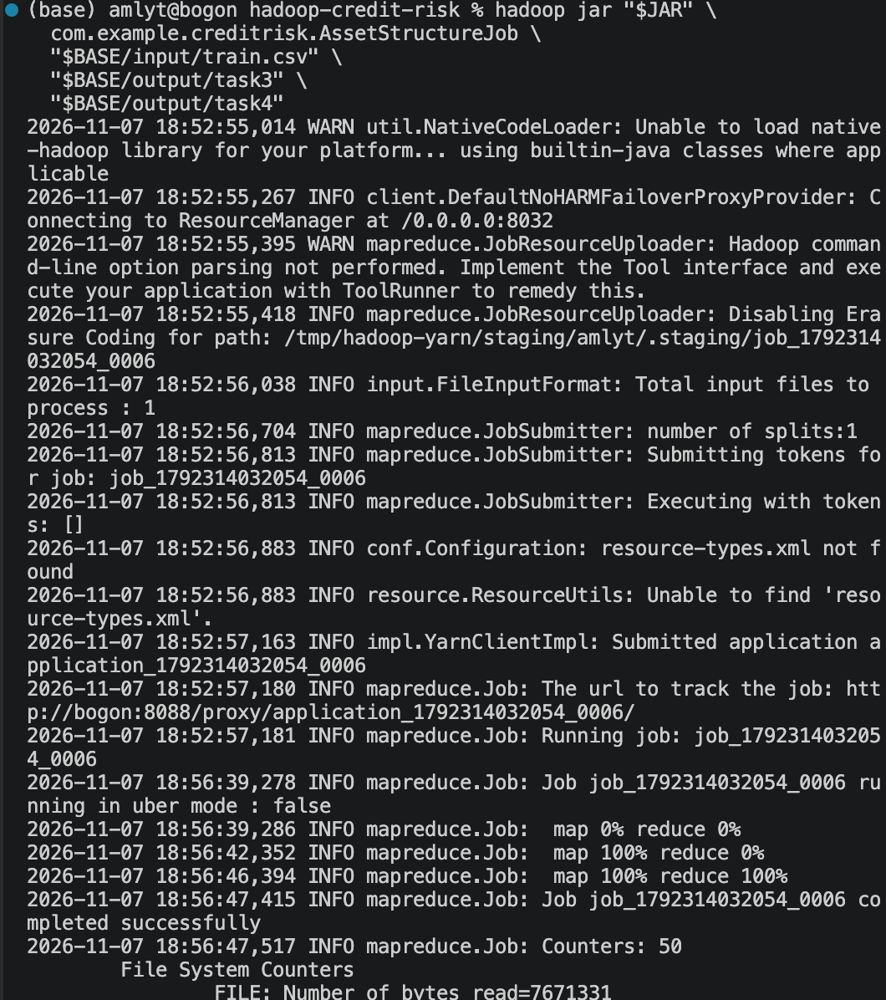

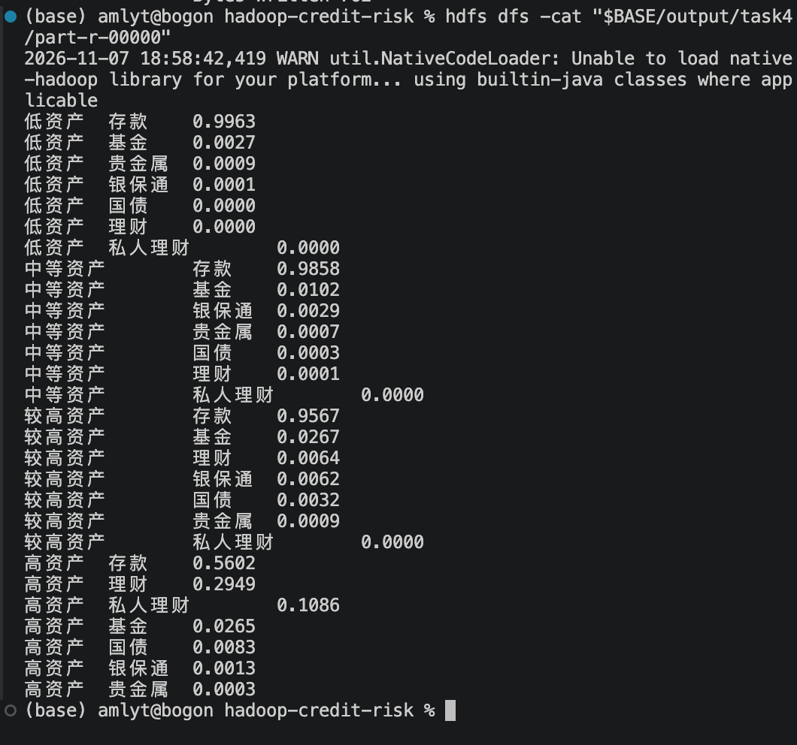


## 8. 任务 5：朴素贝叶斯模型训练与预测

### 8.1 模型与特征设计

程序采用**离散特征朴素贝叶斯（Categorical Naive Bayes）**：

1. 以训练数据中的 `bad_good` 作为类别标签；
2. 使用开户机构、贷款与持有标志、金额区间等字段构建离散特征，并将任务 3 的资产四分位数档位作为特征；
3. 在训练 Mapper 中生成类别频数和类别-特征值频数，Combiner 和 Reducer 汇总为模型参数；
4. 使用 Hadoop Distributed Cache 将模型参数文件及四分位数信息传递给预测 Mapper；
5. 对无标签的 `test.csv` 计算类别得分，输出 `CUST_ID` 与预测 `bad_good`（0 或 1）。

输出格式：

```text
CUST_ID<TAB>预测bad_good
```

### 8.2 首次训练失败与问题记录

实验中首次训练时，Mapper 与 Combiner 已处理训练数据，但 Reducer 在 Shuffle 获取 Map 输出阶段失败。记录的错误包含：

```text
org.apache.hadoop.mapreduce.task.reduce.Shuffle$ShuffleError
Caused by: java.io.IOException: Exceeded MAX_FAILED_UNIQUE_FETCHES; bailing-out.
```

这是**Shuffle 数据抓取失败的诊断信息**，不代表可直接断言朴素贝叶斯公式错误。实验后续有一轮新的训练成功记录，但文档未完整记下环境修复过程，因此此处不臆测唯一根因。

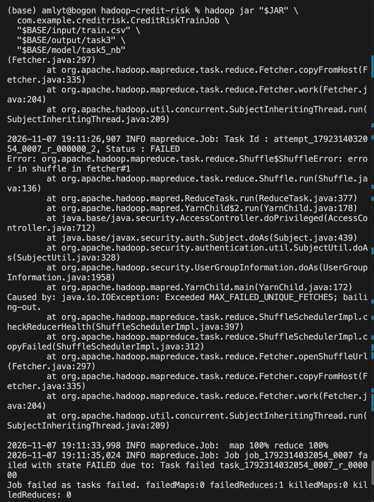

### 8.3 后续训练与预测结果

后续记录中出现了新的 YARN Application，分别是：

- `application_1794051389270_0001`：`task5-credit-nb-training`，最终 `FINISHED / SUCCEEDED`；
- `application_1794051389270_0002`：`task5-credit-nb-prediction`，最终 `FINISHED / SUCCEEDED`。

预测作业的终端日志显示 `completed successfully`，并且 HDFS 输出目录中可以看到客户编号与预测标签。截图展示的前几条预测值为 `0`，这只是部分输出示例，**不能据此断言全部测试客户预测都为 0**。

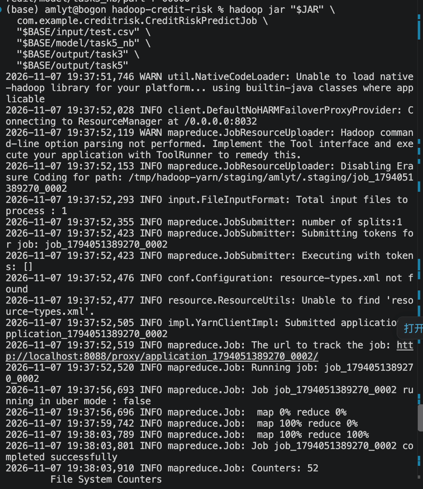

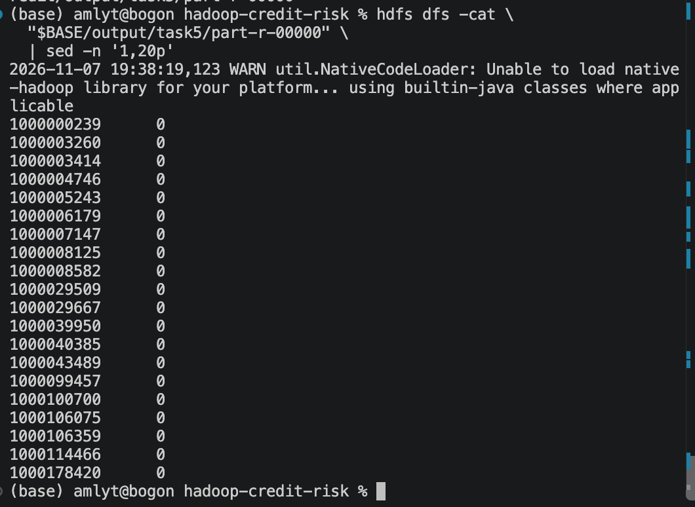

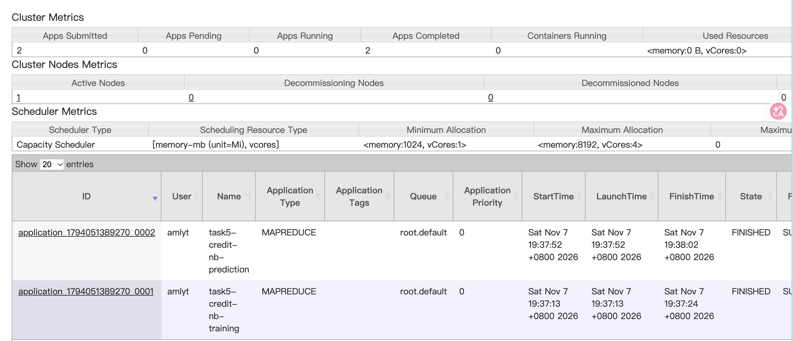

> `test.csv` 没有真实 `bad_good` 标签，因此截图只能证明作业执行和预测输出，不能据此计算准确率、召回率、F1 或 AUC。若要评估模型质量，需另外留出带标签的验证集。

## 9. 运行与复现方法

以下命令与实验项目的类名、HDFS 目录一致。首次复现时先确保 `train.csv` 和 `test.csv` 已放在本地 `input/`，HDFS 与 YARN 已启动；已有输出目录必须先按需备份并清理，MapReduce 不会覆盖同名输出目录。

```bash
# 使用 Java 17
export JAVA_HOME="$(brew --prefix openjdk@17)/libexec/openjdk.jdk/Contents/Home"
export PATH="$JAVA_HOME/bin:$PATH"

# 在 hadoop-credit-risk 根目录编译
mvn clean package

BASE="/user/$USER/credit"
JAR="target/hadoop-credit-risk-1.0.0.jar"

# 上传数据（运行前请确保路径正确）
hdfs dfs -mkdir -p "$BASE/input"
hdfs dfs -put -f input/train.csv "$BASE/input/train.csv"
hdfs dfs -put -f input/test.csv "$BASE/input/test.csv"

# 任务1
hadoop jar "$JAR" com.example.creditrisk.OrgStatsJob \
  "$BASE/input/train.csv" "$BASE/output/task1"

# 任务2：依赖任务1
hadoop jar "$JAR" com.example.creditrisk.OrgAverageJob \
  "$BASE/input/train.csv" "$BASE/output/task1" "$BASE/output/task2"

# 任务3：依赖任务1的客户总数
hadoop jar "$JAR" com.example.creditrisk.QuartilesJob \
  "$BASE/input/train.csv" "$BASE/output/task1" "$BASE/output/task3"

# 任务4：依赖任务3的四分位数
hadoop jar "$JAR" com.example.creditrisk.AssetStructureJob \
  "$BASE/input/train.csv" "$BASE/output/task3" "$BASE/output/task4"

# 任务5：训练模型
hadoop jar "$JAR" com.example.creditrisk.CreditRiskTrainJob \
  "$BASE/input/train.csv" "$BASE/output/task3" "$BASE/model/task5_nb"

# 任务5：用模型预测 test.csv
hadoop jar "$JAR" com.example.creditrisk.CreditRiskPredictJob \
  "$BASE/input/test.csv" "$BASE/model/task5_nb" \
  "$BASE/output/task3" "$BASE/output/task5"
```

查看输出（已成功运行过的项目可以只执行下面这些命令，不必重跑）：

```bash
hdfs dfs -cat "$BASE/output/task1/part-r-00000" | sed -n '1,20p'
hdfs dfs -cat "$BASE/output/task2/part-r-00000" | sed -n '1,20p'
hdfs dfs -cat "$BASE/output/task3/part-r-00000"
hdfs dfs -cat "$BASE/output/task4/part-r-00000"
hdfs dfs -cat "$BASE/model/task5_nb/part-r-00000" | grep '^C|'
hdfs dfs -cat "$BASE/output/task5/part-r-00000" | sed -n '1,20p'
```

**不要重新执行 `hdfs namenode -format`。** 已存在的任务数据和旧作业结果应优先保存；需要重跑时，仅清理当前实验相应的 HDFS 输出目录。

## 10. 实验验证与结论

从实验记录可直接验证：

- 任务 1～4 均输出了所要求的统计结果，并在 YARN 中显示 `SUCCEEDED`。
- 任务 3 输出 Q25=`1127.35`、Q50=`6501.38`、Q75=`49173.11`；任务 4 利用了这些阈值进行资产分组。
- 任务 2 的样例机构中，“大于等于均值”与“低于均值”的人数之和等于任务 1 的机构客户数，符合分组口径。
- 任务 5 发生过 Shuffle 抓取失败；后续新作业成功完成训练与预测，且生成了预测结果文件。
- 现有证据证明实验流程能够运行，但**不能证明模型的预测准确率**；完整性能评价还需要测试集规模核验及有标签验证集的质量指标。

后续优化可以考虑更系统的异常数据校验、类别不均衡处理、模型效果评估、金额分桶策略优化，以及保留 YARN / NodeManager 故障日志用于复现 Shuffle 问题。

## 11. 性能、扩展性分析与优化改进

### 11.1 实验运行性能概述

本实验基于 Hadoop 3.5.0 和 Java 17，在 macOS 单机伪分布式环境中实现了五项用户信贷数据分析任务，包括机构资产统计、机构平均资产比较、资产四分位数计算、资产结构分析以及朴素贝叶斯信贷风险预测。

任务1～4均成功执行，任务5在首次模型训练过程中遇到 Shuffle 数据传输异常，经过环境和网络问题排查后，后续运行记录显示模型训练与测试集预测作业均成功完成。

根据任务5首次训练时的 Hadoop MapReduce Counters，可以得到以下实际指标：

| 性能指标                   |      实测结果 |
| ---------------------- | --------: |
| Map Input Records      |   285,286 |
| 有效训练记录数                |   285,285 |
| Map Output Records     | 4,279,275 |
| Combine Input Records  | 4,279,275 |
| Combine Output Records |     1,977 |
| Spilled Records        |     3,954 |
| Map Task 数量            |         1 |
| Reduce Task 配置数量       |         1 |
| 首次训练作业状态               |    FAILED |

需要说明的是，上述 Counters 来自首次失败的训练作业，用于分析数据处理量、Combiner 的压缩效果及 Shuffle 阶段的问题，不能直接作为最终成功作业的性能测试结果。

从这些数据可以看出，本实验的主要计算过程已经通过 Hadoop MapReduce 实现，但当前程序仍然存在并行度不足、任务调度开销较大、全局排序依赖单 Reducer、重复数据读取以及模型预测能力尚未量化验证等问题。

### 11.2 MapReduce 并行度不足

**（1）存在的问题**

本实验在单机伪分布式 Hadoop 环境中运行，虽然采用了 HDFS 和 YARN，但所有计算仍然依赖同一台物理计算机。

从任务5首次训练记录可以看到，处理约28.5万条有效客户数据时，Hadoop 仅启动了一个 Map Task，程序配置了一个 Reduce Task。

这意味着虽然程序使用了分布式计算框架，但实际计算并没有充分体现多节点并行处理的优势。

特别是在 Reduce 阶段，多个 Mapper 的结果如果都汇集到单个 Reducer，就会形成计算瓶颈。

**（2）对扩展性的影响**

当数据规模由几十万条增长到几百万甚至上亿条时，单个 Reducer 可能需要承担大量分组、排序和聚合操作。

即使增加集群节点数量，最终汇总阶段仍可能受到单个 Reducer 处理能力的限制，从而影响整个作业的执行效率。

**（3）改进方案**

对于任务1、任务2和任务5模型训练等可以按 Key 独立聚合的计算，可以根据数据规模适当增加 Reducer 数量，例如：

```java
job.setNumReduceTasks(4);
```

Hadoop 可以按照 Key 的哈希值分配数据，让多个 Reducer 并行执行聚合操作。

需要注意，增加 Reducer 后会产生多个 `part-r-*` 文件，后续读取任务1或模型结果的程序也需要支持多文件输入，不能继续只读取 `part-r-00000`。

同时，在真正的多节点集群中，可以增加 Map Task 数量，使输入数据分布到不同节点进行处理。

但对于数据规模较小的任务，过多的 Mapper 和 Reducer 也会增加任务启动、调度与通信开销，因此并行度应根据实际数据规模和集群资源进行调整，而不是越大越好。

### 11.3 Shuffle 数据传输开销较大

**（1）存在的问题**

任务5采用离散朴素贝叶斯算法，Mapper 需要统计类别数量以及各类别下不同特征值的出现频数。

由于每条有效训练记录会输出一条类别计数和14条特征计数，因此约28.5万条记录产生了427万余条 Map 中间记录。

这说明 MapReduce 在处理原始数据时会生成数量较大的中间键值对。

如果所有中间记录直接进入 Shuffle 阶段，将增加网络传输、磁盘写入、排序和合并的开销。

**（2）已有优化效果**

本实验使用了 Combiner，在 Mapper 本地提前合并相同 Key 的统计值。

首次训练运行记录显示：

| 指标                     |        数量 |
| ---------------------- | --------: |
| Combine Input Records  | 4,279,275 |
| Combine Output Records |     1,977 |

以记录条数计算，Combiner 的压缩比例约为：

$$
1-\frac{1977}{4279275}\approx99.954\%
$$

也就是说，在这次运行中，Combiner 将427万余条中间记录减少为1977条。

这一结果说明，对于可以执行局部聚合的统计型任务，Combiner 能显著减少后续需要处理的中间记录数量。

但记录数量减少并不意味着网络字节数或运行时间也一定降低相同比例。

**（3）改进方案**

在保留 Combiner 的基础上，可以考虑以下优化：

* 使用更紧凑的中间数据格式，减少字符串序列化带来的额外空间开销。
* 使用自定义 Hadoop Writable 类型替代频繁拼接字符串，减少对象创建及解析成本。
* 对高频统计值在 Mapper 内部进行预聚合，再批量输出中间结果。
* 根据实际数据规模调整 MapReduce Shuffle 缓冲区、排序和溢写相关参数。
* 对适合压缩的中间数据启用 Map 输出压缩，减少 Shuffle 网络传输字节数。

需要特别注意，Mapper 内部预聚合会消耗内存，因此对于高基数特征，应限制缓存大小，避免发生内存溢出。

### 11.4 全局排序与四分位数计算的性能瓶颈

**（1）存在的问题**

任务3要求计算客户总资产的25%、50%和75%分位数。

本实验利用 Hadoop Shuffle 阶段的排序机制，将客户资产作为排序 Key，并通过一个 Reducer 获得全局有序资产序列，再计算四分位数。

这一方案能够实现实验要求，并保证最终分位数来自全局排序结果。

但由于所有数据都进入同一个 Reducer，排序结果的集中处理会限制并行效率。

**（2）对扩展性的影响**

随着客户数据规模不断增大，排序涉及的中间数据量也会增加。

单个 Reducer 需要处理更多有序记录，容易成为任务执行中的性能瓶颈。

此外，当前使用 `DoubleWritable` 表示资产排序键，大多数普通金额可以正常处理，但对于极大数值或对十进制精度要求较高的场景，仍需要考虑浮点数精度问题。

**（3）改进方案**

如果实验要求必须得到精确分位数，可以采用分区排序策略，将数据分配到多个 Reducer，并根据全局分区边界和各分区记录数量确定分位数位置。

如果允许使用近似分位数，则可以考虑 KLL Sketch、t-digest 等适用于大规模数据的分位数近似算法，减少完整排序的计算成本。

两种方案存在不同的取舍：

| 方案             | 优点        | 不足            |
| -------------- | --------- | ------------- |
| 单 Reducer 全局排序 | 实现简单、结果精确 | 并行度低          |
| 多 Reducer 分区排序 | 可以提高并行度   | 实现复杂，需要全局位置协调 |
| 近似分位数算法        | 适合超大数据集   | 存在可控近似误差      |

本实验为了符合课程对 Shuffle 排序的要求，采用单 Reducer 全局排序。未来面对更大规模的数据，可以根据业务精度要求选择更合适的分位数计算方案。

### 11.5 多任务串行执行带来的额外开销

**（1）存在的问题**

本实验的五项任务具有一定的数据依赖关系：

* 任务2需要读取任务1的机构统计结果。
* 任务4需要读取任务3计算的四分位数。
* 任务5需要读取任务3的四分位数作为资产等级特征。

在当前实现中，每个任务单独提交 MapReduce 作业，多个任务需要分别完成资源申请、ApplicationMaster 初始化、容器启动、HDFS 文件读取以及结果写入等操作。

即使原始数据规模不大，这些固定开销仍然可能在作业总耗时中占据较大比例。

**（2）改进方案**

首先，可以优化任务的依赖关系。

任务1和任务3都只依赖原始训练数据，因此理论上可以独立运行；任务2在任务1完成后运行，任务4在任务3完成后运行。

在资源允许的情况下，可以通过工作流调度系统组织这些依赖，减少不必要的串行等待。

其次，可以考虑复用中间统计结果，避免在不同任务中重复计算相同指标。

对于多次复用的中间文件，可以根据数据规模选择更高效的存储格式，减少解析开销。

最后，对于需要反复迭代或频繁执行的分析任务，可以进一步比较 Hadoop MapReduce 与 Spark 等框架的执行特点。

Spark 对数据复用和迭代计算提供了不同的执行机制，可能更适合复杂分析流程，但是否具有性能优势仍需要在相同硬件和数据条件下进行实际测试。

### 11.6 分布式缓存与模型扩展性分析

**（1）当前实现**

任务5的模型预测使用 Hadoop Distributed Cache，将训练生成的朴素贝叶斯模型文件分发到预测任务的 Mapper。

Mapper 在初始化时加载模型，然后对分配到的客户记录进行预测。

这一方式避免了对每一条客户记录重复从 HDFS 读取模型文件，适合体积较小的统计模型。

**（2）存在的不足**

随着特征数量及特征取值种类增加，朴素贝叶斯模型需要保存的类别条件频数也会增加。

例如，如果增加更多高基数类别特征，模型文件可能显著增大。

在这种情况下，每个 Mapper 都完整加载模型，会增加内存消耗和模型初始化时间。

**（3）改进方案**

可以考虑减少冗余特征、对高基数特征进行合理分组或编码，并采用紧凑的模型存储结构。

对于更大的模型，可以设计分区模型加载机制，避免每个 Mapper 必须将完整模型载入内存。

此外，还可以通过减少重复的字符串对象、使用数组或紧凑的数据结构表示模型参数，降低预测阶段的内存占用。

### 11.7 信贷风险预测模型的不足

**（1）模型假设较强**

本实验采用离散朴素贝叶斯分类算法。

该算法假设在给定类别标签的情况下，各个输入特征之间条件独立。

但是在实际金融业务中，客户存款、理财、基金、总资产及负债等变量之间可能存在较强关联。

例如，客户总资产本身就与多个资产组成字段有关。

因此，朴素贝叶斯的条件独立假设在实际数据中可能难以完全满足，从而影响预测效果。

**（2）数值离散化可能损失信息**

当前程序将金额类数值划分到固定区间，然后作为离散特征进行统计。

这一方法降低了模型训练复杂度，但同一区间的不同金额会被映射成相同特征值。

因此，模型可能丢失部分细粒度金额信息。

后续可以采用基于训练数据分布的分位数分桶，并比较不同分桶方式对模型预测效果的影响。

**（3）类别不平衡问题**

信贷风险预测任务可能存在好客户与风险客户数量分布不均衡的问题。

如果风险客户所占比例较低，模型可能倾向于预测多数类。

例如，即使模型对大部分客户都预测为非风险客户，也可能获得较高的整体准确率，却无法有效识别真正需要关注的风险客户。

因此，除了 Accuracy，还应该重点评价：

* Precision：预测为风险客户的样本中，真实风险客户所占比例。
* Recall：所有真实风险客户中，被正确识别的比例。
* F1-score：Precision 与 Recall 的调和平均数。
* ROC-AUC 或 PR-AUC：衡量模型对不同类别的区分能力。

当前实验主要验证 MapReduce 训练与预测流程，没有提供独立验证集的完整评估结果，因此不能仅根据作业成功运行就认定模型具有较高的预测准确率。

后续可以将带标签的训练集划分为训练集和验证集，再开展模型性能评估，同时避免在特征工程阶段使用验证集信息，以减少数据泄漏。

### 11.8 Hadoop Shuffle 故障与系统稳定性分析

**（1）实验中出现的问题**

任务5首次训练期间，Map Task 已经完成数据处理，但 Reduce Task 在 Shuffle 阶段连续失败，报错信息包括：

```text
ShuffleError: error in shuffle in fetcher#1

Caused by: java.io.IOException:
Exceeded MAX_FAILED_UNIQUE_FETCHES
```

随后排查发现，macOS 主机名为 `bogon`，但系统当时无法正常解析该主机名。

这一问题可能影响 Hadoop 节点之间通过主机名进行网络通信，从而导致 Shuffle 数据获取失败。

不过，由于未获取到完整的 Shuffle 底层连接日志，主机名解析异常应视为高度相关的可疑原因，而不能仅凭现有记录认定为唯一根因。

后续实验记录显示，模型训练和预测作业已经能够成功运行。

**（2）改进方向**

为提高 Hadoop 运行环境的稳定性，可以采取以下措施：

1. 确保 Hadoop 集群节点的主机名能够解析到正确且可访问的 IP 地址。
2. 检查 NodeManager 的 ShuffleHandler 服务及相关端口。
3. 配置适当的日志保留和日志聚合机制，便于作业失败时定位异常。
4. 监控 Map、Reduce、Shuffle 及磁盘 I/O 的运行状态。
5. 合理设置任务重试策略，但避免仅依靠增加重试次数掩盖底层网络故障。

本次问题说明，分布式程序的正确执行不仅依赖业务算法，还依赖节点通信、资源管理及运行环境配置。

### 11.9 后续性能测试与优化验证方案

目前实验已经完成基本功能验证，但尚未进行系统性的性能对照实验。

为了进一步分析 Hadoop MapReduce 的扩展性，可以设计以下测试方案：

| 测试项目          | 对比条件           | 评价指标             |
| ------------- | -------------- | ---------------- |
| 数据规模测试        | 不同客户记录数量       | 作业耗时、吞吐量         |
| Reducer 并行度测试 | 1、2、4个 Reducer | Reduce 耗时、资源消耗   |
| Combiner 优化测试 | 启用与禁用 Combiner | Shuffle 数据量、运行时间 |
| 中间数据压缩测试      | 压缩前与压缩后        | Shuffle 字节数、耗时   |
| 分位数算法测试       | 精确排序与近似算法      | 运行时间、误差          |
| 模型特征测试        | 不同特征组合与分桶策略    | F1、Recall、PR-AUC |
| 集群扩展测试        | 不同节点数量         | 加速比、并行效率         |

建议每组实验重复运行多次，并记录中位数或均值，减少 JVM 预热、系统负载和磁盘缓存等因素造成的随机波动。

对于多节点扩展测试，可以计算加速比：

$$
S(p)=\frac{T(1)}{T(p)}
$$

其中 \(T(1)\) 为单节点执行时间，\(T(p)\) 为 \(p\) 个计算节点执行时间。

还可以计算并行效率：

$$
E(p)=\frac{S(p)}{p}
$$

通过这些指标评价增加节点是否能够带来相应的性能提升。

需要强调的是，上述测试属于后续实验设计，目前尚未获得这些对照实验的真实数据，因此不能将预期优化效果写成已经验证的实验结论。

### 11.10 综合分析与总结

总体来看，本实验完成了从 Hadoop 数据存储、MapReduce 数据统计、Shuffle 排序、分布式缓存到机器学习模型训练及预测的完整处理流程。

从实际运行记录中可以发现，Combiner 对朴素贝叶斯模型训练产生的大量中间键值对具有明显的压缩效果，体现了 MapReduce 局部聚合机制的优势。

但单机伪分布式环境仍然限制了系统的并行计算能力，单 Reducer 全局排序、多个独立作业重复读取数据以及模型特征离散化等设计也存在进一步优化的空间。

本次 Shuffle 故障还表明，分布式系统的稳定性受到节点地址解析、网络通信和服务配置等因素的影响，需要将运行环境维护与程序性能优化结合起来。

后续可以从三个方向持续改进：

**第一，计算性能优化。** 通过增加适当的并行度、优化 Shuffle 和中间数据格式、减少重复计算，提高数据处理效率。

**第二，系统扩展性优化。** 将程序部署到真正的多节点 Hadoop 集群，使用不同规模的数据集验证系统的并行扩展能力。

**第三，模型效果优化。** 通过特征选择、合理的数值分桶、类别不平衡处理和独立验证集评估，提高信贷风险预测模型的可靠性。

通过这些改进，可以使本实验从基础的 Hadoop MapReduce 功能实现，进一步发展为具有更强数据处理能力、可扩展性和实际应用价值的分布式金融数据分析系统。

## 12. 截图索引
GitHub 会按本文相对路径直接显示图片。

| 图片 | 说明 |
| --- | --- |
| [`task1-output.png`](screenshots/task1-output.png) | 机构客户数、资产、负债及标签统计输出 |
| [`task1-yarn-success.png`](screenshots/task1-yarn-success.png) | 任务1的 YARN 记录（同时包含旧股票项目） |
| [`task1-execution.png`](screenshots/task1-execution.png) | 任务1运行与完成日志 |
| [`task2-execution.png`](screenshots/task2-execution.png) | 任务2运行与完成日志 |
| [`task2-output.png`](screenshots/task2-output.png) | 任务2机构均值比较输出 |
| [`task2-yarn-success.png`](screenshots/task2-yarn-success.png) | 任务2的 YARN 成功状态 |
| [`task3-quartiles-output.png`](screenshots/task3-quartiles-output.png) | 任务3的 Q25/Q50/Q75 实际数值 |
| [`task3-yarn-success.png`](screenshots/task3-yarn-success.png) | 任务3的 YARN 成功状态 |
| [`task3-execution.png`](screenshots/task3-execution.png) | 任务3运行与完成日志 |
| [`task4-yarn-success.png`](screenshots/task4-yarn-success.png) | 任务4的 YARN 成功状态 |
| [`task4-execution.png`](screenshots/task4-execution.png) | 任务4运行与完成日志 |
| [`task4-asset-structure-output.png`](screenshots/task4-asset-structure-output.png) | 四档资产等级的七类资产占比 |
| [`task5-training-shuffle-failure.png`](screenshots/task5-training-shuffle-failure.png) | 任务5初次训练发生 Shuffle 抓取失败 |
| [`task5-prediction-execution.png`](screenshots/task5-prediction-execution.png) | 任务5后续预测作业运行成功 |
| [`task5-prediction-output.png`](screenshots/task5-prediction-output.png) | 任务5预测结果节选 |
| [`task5-yarn-final-success.png`](screenshots/task5-yarn-final-success.png) | 任务5后续训练、预测两个作业最终完成 |


## 13. 数据与仓库发布说明

实验数据包含客户级记录与财务字段。除非课程数据许可明确允许，**不建议在公开 GitHub 仓库提交完整 `train.csv`、`test.csv` 或客户级预测结果**。可以提交 Java 源码、Maven 配置、去标识化说明、运行命令、截图和必要的统计汇总。公开之前请确认所有截图及输出也符合课程的数据使用规定。
